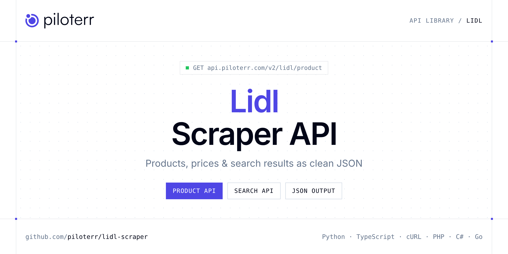

<p align="center">
  <a href="https://www.piloterr.com"></a>
</p>

# Lidl Scraper API

[](https://discord.gg/CFj3ph8aHU) [](https://app.piloterr.com) [](https://app.piloterr.com/openapi) [](LICENSE)

The **Piloterr Lidl Scraper API** lets you extract public data from Lidl as **clean, structured JSON** — no proxies, headless browsers or HTML parsing to maintain. Endpoints available in production:

- **Lidl Product API** — Lidl Product API: fetch full product page data from a Lidl URL or ERP id.
- **Lidl Search API** — Lidl Search API: search product listings by keyword or URL across Lidl online shops in 27 countries.

Use it for price monitoring, assortment tracking, competitor analysis, product research or catalog enrichment.

| Endpoint | Path | Credits | What you get |
|---|---|---|---|
| [Lidl Product API](#lidl-product-api) | `/v2/lidl/product` | 1 | Lidl Product API |
| [Lidl Search API](#lidl-search-api) | `/v2/lidl/search` | 1 | Lidl Search API |

## Table of contents

- [How it works](#how-it-works)
- [Lidl Product API](#lidl-product-api)
- [Lidl Search API](#lidl-search-api)
- [Code examples in other languages](#code-examples-in-other-languages)
- [Practical use cases](#practical-use-cases)
- [Why Piloterr?](#why-piloterr)
- [FAQ](#faq)
- [Related scrapers](#related-scrapers)
- [Support](#support)

## How it works

1. **Create a free Piloterr account** and copy your API key from the [dashboard](https://app.piloterr.com).
2. **Send a `GET` (or `POST`) request** to `https://api.piloterr.com/v2/...` with the header `x-api-key: YOUR_API_KEY`.
3. **Receive structured JSON** — Piloterr handles rendering, proxies, retries and parsing.

```bash
export PILOTERR_API_KEY="your-api-key"
pip install requests        # Python
# TypeScript: Node.js 18+ (native fetch), run with `npx tsx file.ts`
```

> Every endpoint accepts both `GET` (query string) and `POST` (JSON body with the same fields).

## Lidl Product API

Lidl Product API: fetch full product page data from a Lidl URL or ERP id. Returns pricing, images, description, availability and category via Nuxt SSR parsing.

`GET | POST https://api.piloterr.com/v2/lidl/product` · **1 credit per request** · [Full reference](https://app.piloterr.com/openapi)

### Request parameters

| Parameter | Type | Required | Description |
|---|---|---|---|
| `query` | string | ✅ | Lidl product URL or ERP id. |
| `region` | string | — | Target country when `query` is an ERP id only (default: `fr`). Ignored for full product URLs. |
| `return_page_source` | boolean | — | When `true`, return the raw HTML page source as `{"result": "..."}` instead of structured JSON. Defaults to `false`. |

### Python example

```python
import json
import os
import requests

response = requests.get(
    "https://api.piloterr.com/v2/lidl/product",
    headers={"x-api-key": os.environ["PILOTERR_API_KEY"]},
    params={
        "query": "100397447",
    },
    timeout=120,
)
response.raise_for_status()
data = response.json()

print(json.dumps(data, indent=2, ensure_ascii=False)[:2000])
```

### TypeScript example

```typescript
type LidlProduct = {
  url?: string;
  brand?: string;
  price?: number;
  title?: string;
  images?: string[];
  locale?: string;
  rating?: number;
  category?: string;
  currency?: string;
  in_stock?: boolean;
  image_url?: string;
  old_price?: number;
  product_id?: string;
  description?: string;
  availability?: string;
  review_count?: number;
  availability_text?: string;
  discount_percentage?: number;
};

const params = new URLSearchParams({
  "query": "100397447",
});

const response = await fetch(`https://api.piloterr.com/v2/lidl/product?${params}`, {
  headers: { "x-api-key": process.env.PILOTERR_API_KEY! },
});
if (!response.ok) throw new Error(`Piloterr error ${response.status}: ${await response.text()}`);

const data = (await response.json()) as LidlProduct;

console.log(JSON.stringify(data, null, 2).slice(0, 2000));
```

<details>
<summary><b>POST variant</b></summary>

```http
POST https://api.piloterr.com/v2/lidl/product
x-api-key: YOUR_API_KEY
Content-Type: application/json

{"query": "100397447"}
```
</details>

### Output example

Example response from the API reference, abridged — real values depend on the page you scrape.

```json
{
  "url": "https://www.lidl.fr/p/parkside-perceuse-a-percussion-psbm-750-b3-10-nm-750-w/p100397447",
  "brand": "PARKSIDE®",
  "price": 17.99,
  "title": "PARKSIDE® Perceuse à percussion PSBM 750 B3, 10 Nm, 750 W",
  "images": [
    "https://www.lidl.fr/assets/gcp8943e01124db4b4b8be1424510edcc10.jpg"
  ],
  "locale": "fr-fr",
  "rating": 4.2,
  "category": "Assortiment/Bricoler/Atelier/.../Perceuses à percussion",
  "currency": "EUR",
  "in_stock": true,
  "image_url": "https://www.lidl.fr/assets/gcp8943e01124db4b4b8be1424510edcc10.jpg",
  "old_price": 31.99,
  "product_id": "100397447",
  "description": "<h3>PARKSIDE® Perceuse à percussion PSBM 750 B3, 10 Nm, 750 W</h3>",
  "availability": "in_stock",
  "review_count": 145,
  "availability_text": "Disponible à la livraison",
  "discount_percentage": 43
}
```

### Response fields

| Field | Type | Description |
|---|---|---|
| `url` | string |  |
| `brand` | string |  |
| `price` | number |  |
| `title` | string |  |
| `images` | string[] |  |
| `locale` | string |  |
| `rating` | number |  |
| `category` | string |  |
| `currency` | string |  |
| `in_stock` | boolean |  |
| `image_url` | string |  |
| `old_price` | number |  |
| `product_id` | string |  |
| `description` | string |  |
| `availability` | string |  |
| `review_count` | integer |  |
| `availability_text` | string |  |
| `discount_percentage` | integer |  |

## Lidl Search API

Lidl Search API: search product listings by keyword or URL across Lidl online shops in 27 countries. Parses Nuxt SSR payload from HTML; returns prices, ratings, brand and pagination.

`GET | POST https://api.piloterr.com/v2/lidl/search` · **1 credit per request** · [Full reference](https://app.piloterr.com/openapi)

### Request parameters

| Parameter | Type | Required | Description |
|---|---|---|---|
| `query` | string | ✅ | Search keyword or full Lidl search URL. |
| `region` | string | — | Target country when `query` is a keyword (default: `fr`). |
| `page` | number | — | 1-based page number (default: 1). Lidl paginates by offset (`48` items per page). |
| `return_page_source` | boolean | — | When `true`, return the raw HTML page source as `{"result": "..."}` instead of structured JSON. Defaults to `false`. |

### Python example

```python
import json
import os
import requests

response = requests.get(
    "https://api.piloterr.com/v2/lidl/search",
    headers={"x-api-key": os.environ["PILOTERR_API_KEY"]},
    params={
        "query": "perceuse",
    },
    timeout=120,
)
response.raise_for_status()
data = response.json()

print(json.dumps(data, indent=2, ensure_ascii=False)[:2000])
```

### TypeScript example

```typescript
type LidlSearch = {
  results?: {
    url?: string;
    brand?: string;
    price?: number;
    title?: string;
    locale?: string;
    rating?: number;
    currency?: string;
    image_url?: string;
    old_price?: number;
    product_id?: string;
    review_count?: number;
    discount_percentage?: number;
  }[];
  pagination?: {
    next?: string;
    page?: number;
    per_page?: number;
    total_pages?: number;
    total_results?: number;
  };
};

const params = new URLSearchParams({
  "query": "perceuse",
});

const response = await fetch(`https://api.piloterr.com/v2/lidl/search?${params}`, {
  headers: { "x-api-key": process.env.PILOTERR_API_KEY! },
});
if (!response.ok) throw new Error(`Piloterr error ${response.status}: ${await response.text()}`);

const data = (await response.json()) as LidlSearch;

console.log(JSON.stringify(data, null, 2).slice(0, 2000));
```

<details>
<summary><b>POST variant</b></summary>

```http
POST https://api.piloterr.com/v2/lidl/search
x-api-key: YOUR_API_KEY
Content-Type: application/json

{"query": "perceuse"}
```
</details>

### Output example

Example response from the API reference, abridged — real values depend on the page you scrape.

```json
{
  "results": [
    {
      "url": "https://www.lidl.fr/p/parkside-set-perceuse-a-percussion-psbm-750-c3/p100400894",
      "brand": "PARKSIDE®",
      "price": 20,
      "title": "PARKSIDE® Set perceuse à percussion PSBM 750 C3",
      "locale": "fr-fr",
      "rating": 4,
      "currency": "EUR",
      "image_url": "https://www.lidl.fr/assets/gcp941ea783e919400f859ed3e1193f144f.jpg",
      "old_price": 51.99,
      "product_id": "100400894",
      "review_count": 26,
      "discount_percentage": 61
    }
  ],
  "pagination": {
    "next": "https://www.lidl.fr/q/search?q=perceuse&offset=48&fetchsize=48",
    "page": 1,
    "per_page": 48,
    "total_pages": 4,
    "total_results": 147
  }
}
```

### Response fields

| Field | Type | Description |
|---|---|---|
| `results[]` | object[] |  |
| `results[].url` | string |  |
| `results[].brand` | string |  |
| `results[].price` | integer |  |
| `results[].title` | string |  |
| `results[].locale` | string |  |
| `results[].rating` | integer |  |
| `results[].currency` | string |  |
| `results[].image_url` | string |  |
| `results[].old_price` | number |  |
| `results[].product_id` | string |  |
| `results[].review_count` | integer |  |
| `results[].discount_percentage` | integer |  |
| `pagination` | object |  |
| `pagination.next` | string |  |
| `pagination.page` | integer |  |
| `pagination.per_page` | integer |  |
| `pagination.total_pages` | integer |  |
| `pagination.total_results` | integer |  |

## Code examples in other languages

Ready-to-run examples live in the [`examples/`](examples) folder. Each one reads your key from the `PILOTERR_API_KEY` environment variable.

| Language | Product | Search |
|---|---|---|
| cURL (Bash) | [`product`](examples/curl/product.sh) | [`search`](examples/curl/search.sh) |
| PHP | [`product`](examples/php/product.php) | [`search`](examples/php/search.php) |
| C# | [`product`](examples/csharp/Product.cs) | [`search`](examples/csharp/Search.cs) |
| Go | [`product`](examples/go/product.go) | [`search`](examples/go/search.go) |
| Java | [`product`](examples/java/ProductExample.java) | [`search`](examples/java/SearchExample.java) |
| Ruby | [`product`](examples/ruby/product.rb) | [`search`](examples/ruby/search.rb) |
| Node.js | [`product`](examples/nodejs/product.mjs) | [`search`](examples/nodejs/search.mjs) |

## Practical use cases

- **Price monitoring** — Track prices, promotions and availability over time to react to competitors.
- **Assortment & catalog tracking** — Follow new products, delisted items and category changes.
- **Competitor analysis** — Benchmark ranges, brands and positioning across retailers.
- **Product research** — Spot best-sellers and trends from search results.
- **Catalog enrichment** — Pull titles, images and attributes into your PIM or marketplace listings.

## Why Piloterr?

- **No infrastructure** — no proxies, headless browsers or CAPTCHA solving to run yourself.
- **Structured JSON** — stable, documented fields instead of brittle HTML selectors.
- **Pay per request** — transparent credit cost per endpoint, failed requests are retried for you.
- **One API key, hundreds of sources** — Lidl plus many other e-commerce, search and company data endpoints in the [Piloterr library](https://www.piloterr.com/library).
- **Any language** — plain HTTPS + JSON, with examples for Python, TypeScript, cURL, PHP, C#, Go, Java, Ruby and Node.js.

## FAQ

### Is it legal to scrape Lidl?

Collecting publicly available data is generally allowed in many jurisdictions, but rules depend on your country, the data you collect and how you use it. Avoid personal data unless you have a lawful basis, respect the website's terms where they apply, and get legal advice for your specific use case. This is not legal advice.

### Do I need proxies or a headless browser?

No. Piloterr handles rendering, proxy rotation and retries on its side. You only send an HTTPS request with your `x-api-key` header and receive JSON.

### How much does a request cost?

Credits per call: `/v2/lidl/product` **1**, `/v2/lidl/search` **1**. See the [Piloterr website](https://www.piloterr.com) for plans.

### What data does the Lidl API return?

Each endpoint returns structured JSON: **Lidl Product** — `url`, `brand`, `price`, `title`, `images`, `locale`; **Lidl Search** — `results[]`, `results[].url`, `results[].brand`, `results[].price`, `results[].title`, `results[].locale`.

### How do I paginate Lidl results?

Use the `page` parameter and keep requesting while the response indicates more results.

### Can I target a specific country or language?

Yes, use `region` — see the parameter tables above for accepted values.

### Can I get the raw HTML instead of JSON?

Yes. Set `return_page_source=true` and the response becomes `{"result": "..."}` with the page source.

### Which languages are supported?

Any language that can make an HTTP request. This README shows Python and TypeScript; the [`examples/`](examples) folder contains cURL, PHP, C#, Go, Java, Ruby and Node.js.

## Related scrapers

- [About You Scraper API](https://github.com/piloterr/aboutyou-scraper)
- [Action Scraper API](https://github.com/piloterr/action-scraper)
- [Aldi Scraper API](https://github.com/piloterr/aldi-scraper)
- [Alibaba Scraper API](https://github.com/piloterr/alibaba-scraper)
- [AliExpress Scraper API](https://github.com/piloterr/aliexpress-scraper)
- [Allegro Scraper API](https://github.com/piloterr/allegro-scraper)
- [All Piloterr scrapers on GitHub](https://github.com/piloterr)

## Support

- 💬 Join the [Piloterr Discord](https://discord.gg/CFj3ph8aHU) to ask questions and share what you build.
- 📚 Browse the [API reference (OpenAPI)](https://app.piloterr.com/openapi) and the [Piloterr library](https://www.piloterr.com/library).
- 🔑 [Get your API key](https://app.piloterr.com).

---

<p align="center">
  <a href="https://www.piloterr.com">
    <picture>
      <source media="(prefers-color-scheme: dark)" srcset="images/logo-dark.svg">
      
    </picture>
  </a>
  <br>
  <sub>Built by <a href="https://www.piloterr.com">Piloterr</a> — web scraping APIs for e-commerce, search, real estate and more, one API key.</sub>
</p>

<sub>Lidl is a trademark of its respective owner. This repository is not affiliated with or endorsed by Lidl. Examples are released under the MIT license.</sub>
